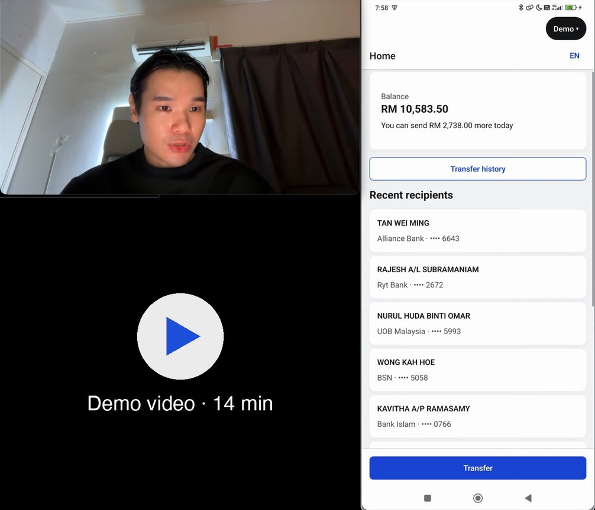

# Ryt Transfer

Android and iOS, React Native, Expo SDK 57, TypeScript. Features:

1. Transfer
2. Transfer History List

All handled transfer scenarios are detailed in the [scenario matrix](src/screens/transfer/scenarios/transfer.md)

## Install direct from APK

1. Download [ryt-transfer-demo.apk](https://github.com/chiewwengkeat/ryt-transfer/releases/latest) and install on your Android phone
2. Full-featured: BE API calls are simulated with an API layer
3. See `Demo` button on top right of screen, to simulate many scenarios. [See demo video below](#demo-video)

## Demo video

[](https://youtu.be/JoYJbxgE1o0)

## Write-ups

1. [Main summarized write-up](docs/write-up.md)
2. [More in-depth design decisions](docs/deep-dives/design-decisions/). Recommendations:
   1. [Folder architecture](docs/deep-dives/design-decisions/001-vertical-slices.md)
   2. [Architectural principle](docs/deep-dives/design-decisions/011-low-mental-load.md)

## Run locally

You need:

1. Node 22.13 or later
2. pnpm 10.5 or later
3. For Android: Android Studio with an emulator, JDK 17, and `ANDROID_HOME` set (on a Mac: `export ANDROID_HOME=$HOME/Library/Android/sdk`)
4. For iOS: Xcode 16.1 or later, and CocoaPods (`brew install cocoapods`)

Then:

```sh
pnpm install
pnpm android:demo   # or: pnpm ios:demo
```

## Assumptions

1. **A Malaysian bank's customer**: ringgit only, amounts as integer sen, times in Malaysia time
2. **Transfers go over DuitNow**, to an ID or a bank account; BE, never FE, looks up the registered name
3. **The module runs inside the bank's own app** (the host app), which owns sign-in and the PIN, and passes the module [two inputs](docs/deep-dives/features.md#for-the-host-app): its biometrics setting and a completed PIN reset
4. **The API is designed here**: no BE exists, so each endpoint's types are a proposed API contract
5. **Create, then approve**: Create Transfer checks balance and limits; only Approve Transfer moves money
6. **Limits are the mock BE's**: RM5,000 a day, RM50,000 per transfer, 60 seconds to approve, three PIN attempts
7. **Several FE consumers, one behaviour**: sister FE repos (web, a lite app) implement the same flows, transfer included, and must handle every scenario identically. Hence one [scenario matrix](src/screens/transfer/scenarios/transfer.md) they all follow ([002](docs/deep-dives/design-decisions/002-scenario-matrix.md))
8. **The app keeps growing**: many more features, added by FE engineers new to the codebase, with no context of the whole system or its patterns. Hence a folder structure where each component's place follows from who uses it, enforced by lint ([001](docs/deep-dives/design-decisions/001-vertical-slices.md), [011](docs/deep-dives/design-decisions/011-low-mental-load.md))
