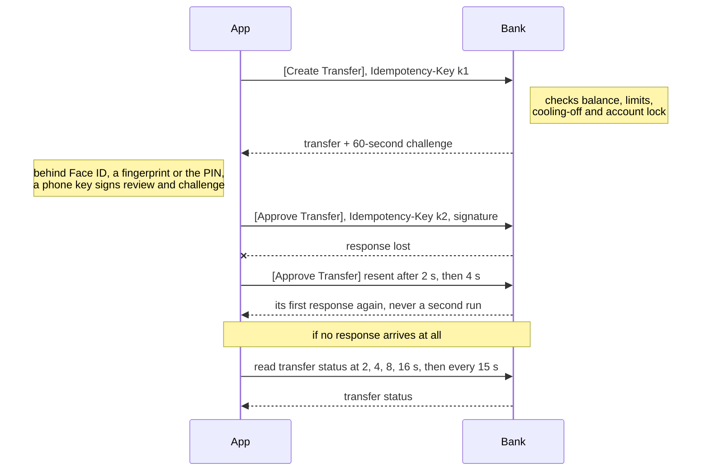
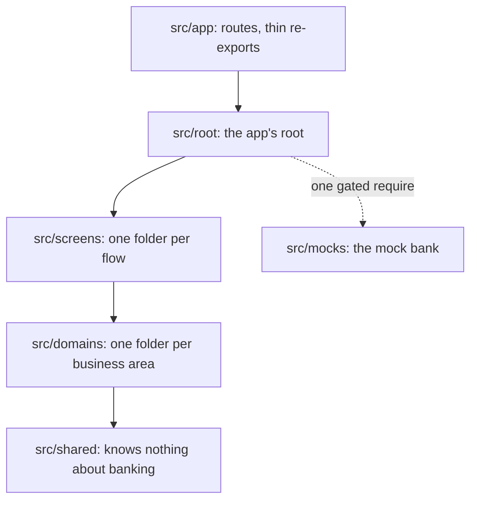

# Write-up

**Transfer flow:**

1. Create Transfer API call
2. Approve Transfer API call

**Notes**

1. Both API calls carry an `Idempotency-Key`:
   1. A transfer is never created or approved twice
   2. With no response (e.g. network loss), FE resends with the same key; BE returns its first response instead of running it again
2. Approve Transfer API call carries a signature ([details](#approval-signs-exactly-what-you-saw)):
   1. BE verifies it covers exactly what review showed, so nothing is swapped in between
   2. Signed by a hardware-backed key, unlocked by Face ID or a fingerprint; without biometrics, a PIN BE checks

## Approval signs exactly what you saw

Approval signs what review showed ([003](deep-dives/design-decisions/003-biometric-approval.md)):

1. Face ID or a fingerprint unlocks a hardware-backed key on the phone
2. The key signs the transfer details and BE's 60-second challenge
3. BE verifies the signature

**Characteristics**:

1. Tamper-proof: nothing can change between what the user saw and what BE executes
2. Proves who approved what, which a pass/fail biometric prompt can't
3. Works without biometrics: a PIN that BE verifies, never the device passcode
4. One trust boundary at BE, so every client follows the same rule

**Rejected designs**:

1. **Fallback key unlocked by the device passcode**. Reason: family members often know it

## A transfer can never be sent twice

Create, then approve; only approval moves money ([006](deep-dives/design-decisions/006-never-sent-twice.md)):

1. Every mutation carries an `Idempotency-Key`
2. BE returns its first response to a repeated key
3. With no response, FE retries, then polls the transfer status

**Characteristics**:

1. Safe retries: a lost response can never pay twice
2. Validation errors reach the user before they approve
3. No retry is offered until the outcome is known, even after an app restart
4. The guarantee is BE's API contract, so any client gets it

**Rejected designs**:

1. **One API call that validates and moves money**. Reason: validation errors would arrive only after approval

## Every scenario is written down once

All 58 transfer scenarios live in one file, [the scenario matrix](../src/screens/transfer/scenarios/transfer.md) ([002](deep-dives/design-decisions/002-scenario-matrix.md)):

1. Per scenario: the money state, the message to show, the actions to never offer
2. Tests, the mock BE, translations and the Demo menu share its scenario ids

**Characteristics**:

1. One source of truth: every client and rewrite implements against the same file
2. Product owners can edit it
3. Enforced: [checks](../src/screens/transfer/scenarios/transfer.strings.check.test.ts) fail wording that hides the money state or offers a forbidden retry, and [ids that drift apart](../src/screens/transfer/scenarios/transfer.check.test.ts)

**Rejected designs**:

1. **Exact copy in the matrix**. Reason: binds every client to one wording

## Fast with a long history

History stays fast over 5,000 transfers ([009](deep-dives/design-decisions/009-history-at-scale.md)):

1. Cursor pagination, with per-day totals from BE
2. A virtualized list that recycles rows
3. A 30-second cache window before refetching
4. Server state in TanStack Query ([010](deep-dives/design-decisions/010-query-cache-only.md)), flow state in zustand ([005](deep-dives/design-decisions/005-state.md))

**Characteristics**:

1. No duplicated or missing rows when transfers land mid-scroll
2. Day totals stay correct across page boundaries
3. Measured, not assumed: appending a page re-renders no visible row ([counts](deep-dives/history-re-render-counts.md))
4. The same contract for every client

**Rejected designs**:

1. **Offset pagination**. Reason: a transfer landing mid-scroll duplicates a row

## Every component and hook has one place

Vertical slices: a folder per flow, a domain per business area ([001](deep-dives/design-decisions/001-vertical-slices.md), [011](deep-dives/design-decisions/011-low-mental-load.md), [012](deep-dives/design-decisions/012-inline-or-own-folder.md)):

1. Code lives beside its only user, moving up a level when a second user appears
2. Layers import only downward

**Characteristics**:

1. Where code goes follows from the tree, so engineers put the same piece in the same place
2. A flow's code sits together, so a change rarely reaches outside it
3. Lint enforces both rules

**Rejected designs**:

1. **Feature-Sliced Design**. Reason: its six layers split each feature, making "which layer?" a recurring call

## One mock BE for tests and the demo

Development and demo builds have a stateful mock API layer, built with MSW ([004](deep-dives/design-decisions/004-mock-backend.md)):

1. Behaves like BE: balances, limits, idempotency, signatures
2. Persists across app restarts

**Characteristics**:

1. Simulates any scenario a real BE or network can produce, for automated tests and the Demo scenario picker
2. One source for tests and the demo, so an API contract change lands once
3. QA can walk any scenario on an installed build, app restarts included

**Rejected designs**:

1. **Local mock server**. Reason: closest to production, but an installed APK has no server to reach

## The mock BE can't reach production

Production builds never contain mock code ([007](deep-dives/design-decisions/007-production-guard.md)):

1. An unset build variant means production
2. Mock code loads only through one build-time-gated `require`, stripped from release bundles
3. CI checks every exported bundle for mock code

**Characteristics**:

1. Fails closed: a misconfigured build is a production build
2. Checks the built artifact, not the intent, so it holds as the team grows

**Rejected designs**:

1. **One build with a hidden demo mode**. Reason: the mock BE would ship one unlock away from a customer

## Security beyond the fingerprint

Production hardening ([008](deep-dives/design-decisions/008-hardening.md)):

1. Screen capture blocked everywhere but the receipts
2. Approvals refused on rooted or jailbroken devices
3. The app blurred in the iOS app switcher
4. The Android PIN pad ignores touches through other apps' overlays

**Characteristics**:

1. New screens are blocked by default, so none is left capturable by accident
2. Receipts stay capturable as proof of payment
3. An inconclusive device check never blocks a legitimate user, and is logged

**Rejected designs**:

1. **Capture blocked on the transfer steps only**. Reason: leaves History's names and amounts capturable

## Challenges

1. **Back during the device check didn't cancel the transfer**. Fix: the approval re-checks that review is still open after every wait
2. **A bottom-sheet library, reverted on evidence**: open bugs on this exact stack left sheets invisible or unable to reopen. Fix: an own sheet, about 250 lines
3. **A production bundle could include the mock BE**: the bundler's cache ignored the build variant. Fix: the variant is in the cache key, and CI fails a production bundle carrying mock code

## Limits, and what I'd do next

1. Only layouts were verified on a physical device. Next: verify the hardware keys and capture blocking on real devices
2. Device integrity is checked on the phone. Next: BE attests the device (Play Integrity, App Attest)
3. Malay and Chinese are unreviewed machine translations. Next: a native speaker's review
4. The API is a proposed contract. Next: agree it with the bank's BE team

Full list: [limitations.md](deep-dives/limitations.md)
