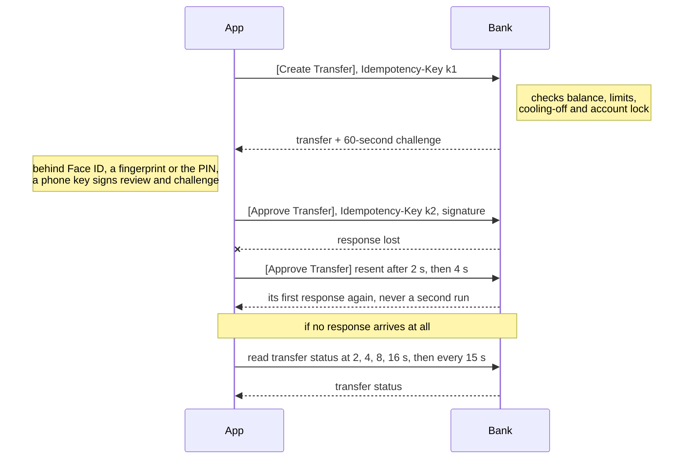
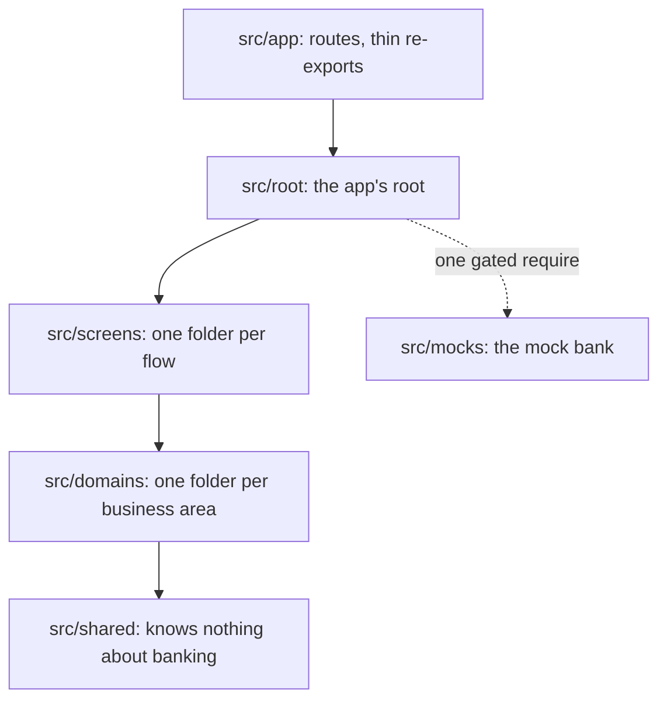

# Write-up

**Transfer flow:**

1. Create Transfer API call
2. Approve Transfer API call

**Notes**

1. Both API calls carry an `Idempotency-Key`:
   1. A transfer is never created or approved twice
   2. With no response (e.g. network loss), FE resends with the same key; BE returns its first response instead of running it again
2. Approve Transfer API call carries a signature ([details](#approval-signs-exactly-what-you-saw)):
   1. BE verifies it covers exactly what review showed, so nothing is swapped in between
   2. Signed by a hardware-backed key, unlocked by Face ID or a fingerprint; without biometrics, a PIN BE checks

## Approval signs exactly what you saw

A hardware-backed key signs what review showed, and BE verifies it ([003](deep-dives/design-decisions/003-biometric-approval.md)).

**Characteristics**:

1. Tamper-proof, and proves who approved what, which a pass/fail biometric prompt can't
2. Works without biometrics: a PIN BE verifies, never the device passcode
3. One trust boundary at BE, so every client follows the same rule

**Rejected designs**:

1. **Fallback key unlocked by the device passcode**. Reason: family members often know it

## A transfer can never be sent twice

Create, then approve; idempotency keys make every retry safe, and FE polls when no response comes ([006](deep-dives/design-decisions/006-never-sent-twice.md)).

**Characteristics**:

1. A lost response can never pay twice
2. Validation errors reach the user before they approve
3. No retry is offered until the outcome is known, even after an app restart

**Rejected designs**:

1. **One API call that validates and moves money**. Reason: validation errors would arrive only after approval

## Every scenario is written down once

All 58 transfer scenarios live in one file, [the scenario matrix](../src/screens/transfer/scenarios/transfer.md): per scenario, the money state, the message and the actions to never offer ([002](deep-dives/design-decisions/002-scenario-matrix.md)).

**Characteristics**:

1. One source of truth for tests, the mock BE, translations and every client
2. Product owners can edit it
3. [Checks](../src/screens/transfer/scenarios/transfer.strings.check.test.ts) fail wording that hides the money state or offers a forbidden retry

**Rejected designs**:

1. **Exact copy in the matrix**. Reason: binds every client to one wording

## Fast with a long history

Cursor pagination with per-day totals from BE, a virtualized list, and a 30-second cache window, over 5,000 transfers; server state in TanStack Query, flow state in zustand ([009](deep-dives/design-decisions/009-history-at-scale.md), [010](deep-dives/design-decisions/010-query-cache-only.md), [005](deep-dives/design-decisions/005-state.md)).

**Characteristics**:

1. No duplicated or missing rows, and correct day totals, when transfers land mid-scroll
2. Measured: appending a page re-renders no visible row ([counts](deep-dives/history-re-render-counts.md))

**Rejected designs**:

1. **Offset pagination**. Reason: a transfer landing mid-scroll duplicates a row

## Every component and hook has one place

Vertical slices: code lives beside its only user and moves up a level when a second user appears; layers import only downward ([001](deep-dives/design-decisions/001-vertical-slices.md), [011](deep-dives/design-decisions/011-low-mental-load.md), [012](deep-dives/design-decisions/012-inline-or-own-folder.md)).

**Characteristics**:

1. Where code goes follows from the tree, so engineers put the same piece in the same place
2. Lint enforces it

**Rejected designs**:

1. **Feature-Sliced Design**. Reason: its six layers split each feature, making "which layer?" a recurring call

## One mock BE for tests and the demo

Development and demo builds have a stateful MSW mock API layer that behaves like BE and persists across restarts ([004](deep-dives/design-decisions/004-mock-backend.md)).

**Characteristics**:

1. Simulates any scenario a real BE or network can produce, for automated tests and the Demo scenario picker
2. An API contract change lands once for tests and the demo

**Rejected designs**:

1. **Local mock server**. Reason: an installed APK has no server to reach

## The mock BE can't reach production

An unset build variant means production, mock code loads only through one build-time-gated `require`, and CI checks every exported bundle for it ([007](deep-dives/design-decisions/007-production-guard.md)).

**Characteristics**:

1. Fails closed, and checks the built artifact rather than the intent

**Rejected designs**:

1. **One build with a hidden demo mode**. Reason: the mock BE would ship one unlock away from a customer

## Security beyond the fingerprint

Capture blocked everywhere but the receipts, approvals refused on rooted or jailbroken devices, an app-switcher blur and an overlay-touch guard on the PIN pad ([008](deep-dives/design-decisions/008-hardening.md)).

**Characteristics**:

1. New screens are blocked by default; receipts stay capturable as proof of payment
2. An inconclusive device check never blocks a legitimate user

**Rejected designs**:

1. **Capture blocked on the transfer steps only**. Reason: leaves History's names and amounts capturable

## Challenges

1. **Back during the device check didn't cancel the transfer**. Fix: the approval re-checks that review is still open after every wait
2. **A bottom-sheet library with open bugs on this exact stack**. Fix: an own sheet, about 250 lines
3. **A production bundle could include the mock BE**, since the bundler's cache ignored the build variant. Fix: the variant is in the cache key

## Limits, and what I'd do next

1. Only layouts were verified on a physical device. Next: verify the hardware keys and capture blocking on real devices
2. Device integrity is checked on the phone. Next: BE attests the device (Play Integrity, App Attest)
3. Malay and Chinese are unreviewed machine translations. Next: a native speaker's review
4. The API is a proposed contract. Next: agree it with the bank's BE team

Full list: [limitations.md](deep-dives/limitations.md)
