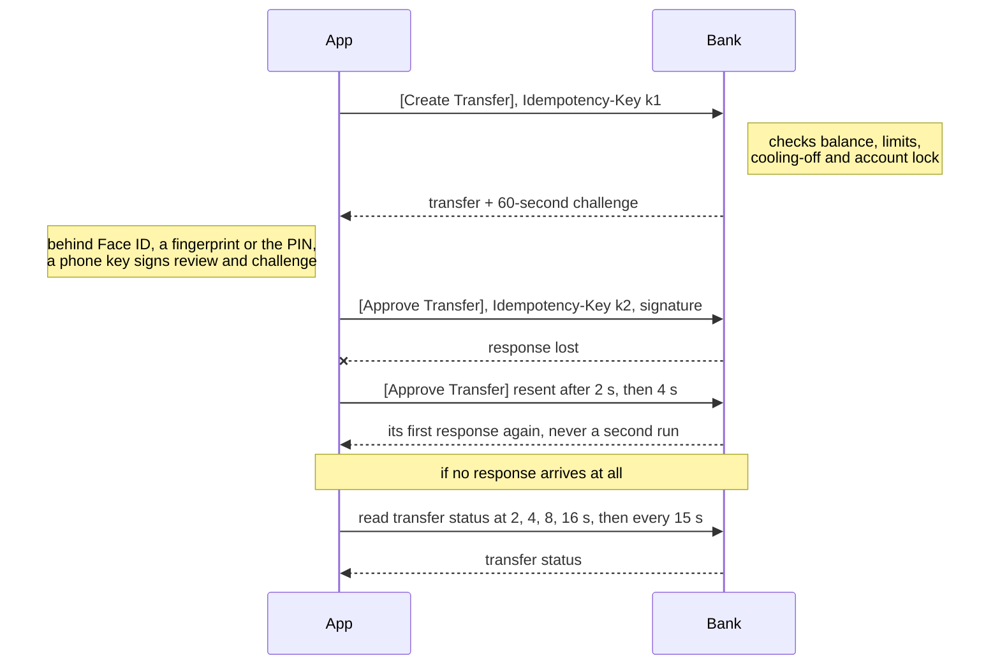
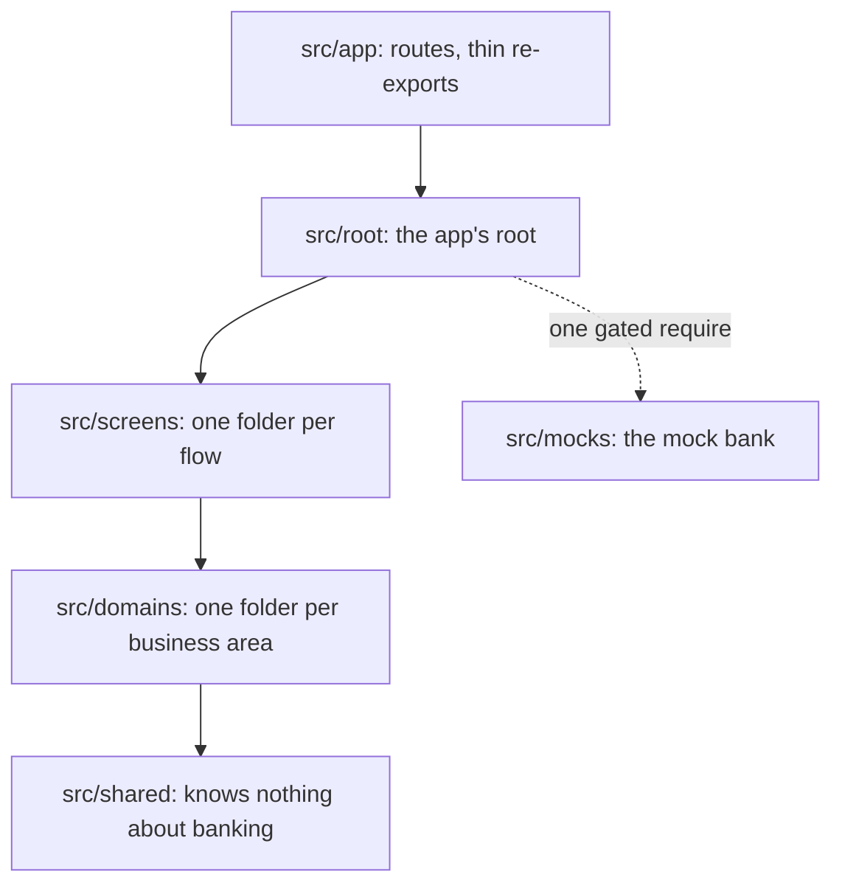

# Write-up

**Transfer flow:**

1. Create Transfer API call
2. Approve Transfer API call

**Notes**

1. Both API calls carry an `Idempotency-Key`:
   1. A transfer is never created or approved twice
   2. With no response (e.g. network loss), FE resends with the same key; BE returns its first response instead of running it again
2. Approve Transfer API call carries a signature ([details](#approval-signs-exactly-what-you-saw)):
   1. BE verifies it covers exactly what review showed (recipient, amount, note, 60-second challenge), so nothing is swapped in between
   2. Signed by a key in the phone's secure hardware, unlocked by Face ID or a fingerprint; without biometrics, a PIN BE checks

## Approval signs exactly what you saw

Approval signs the review payload; a pass/fail biometric prompt alone proves nothing to BE ([003](deep-dives/design-decisions/003-biometric-approval.md)):

1. Face ID or a fingerprint unlocks a private key in the phone's hardware-backed keystore
2. The key signs recipient, amount, note and BE's 60-second challenge
3. BE verifies the signature

**Characteristics**:

1. The payload can't be tampered with between UI and server
2. Without biometrics: a six-digit PIN that BE verifies, plus a second hardware key's signature
3. The device passcode approves nothing
4. BE's signature check is the trust boundary, so every client follows the same rule

**Rejected designs**:

1. **Fallback key unlocked by the device passcode**. Reason: family members often know it

## A transfer can never be sent twice

BE creates the transfer first; only the separate Approve API call moves money ([006](deep-dives/design-decisions/006-never-sent-twice.md)):

1. Every mutation carries an `Idempotency-Key`, re-sent by every retry
2. BE returns its first response to a repeated key for 24 h
3. A lost response (timeout, dropped network, 5xx) is retried; an error response never is
4. If FE's retries never get a response, FE polls the transfer status, even after an app restart

**Characteristics**:

1. No retry is offered until the transfer status is known
2. The guarantee is BE's API contract, so a web or lite client gets it by following the contract

**Rejected designs**:

1. **One API call that validates and moves money**. Reason: validation errors would arrive only after approval

## Every scenario is written down once

Each of the 58 scenarios a transfer can hit is one short section of [the scenario matrix](../src/screens/transfer/scenarios/transfer.md) ([002](deep-dives/design-decisions/002-scenario-matrix.md)):

1. The money state, always one of four
2. The user-facing message
3. Forbidden actions, where it matters

**Characteristics**:

1. Tests, the mock BE, i18n and the Demo menu share its stable scenario ids
2. Where the user must be told the money state, every locale carries that state's fixed phrase
3. Where a retry is forbidden, no pressable element may carry one of nine retry words
4. [A check](../src/screens/transfer/scenarios/transfer.strings.check.test.ts) fails strings that break either rule; [another](../src/screens/transfer/scenarios/transfer.check.test.ts) fails scenario ids that drift apart
5. Every client and rewrite implements against the same file, which product owners can edit

**Rejected designs**:

1. **Exact copy in the matrix**. Reason: binds every client to one wording

## Fast with a long history

History stays fast over a long list ([009](deep-dives/design-decisions/009-history-at-scale.md)):

1. The mock BE seeds 5,000 transfers
2. Cursor pagination, 30 per page
3. BE returns each day's count and net total, so a day split across pages never under-counts
4. FlashList recycles rows

**Characteristics**:

1. Reopened within 30 s of its last fetch, History renders from cache with no request; later, it refetches the first page once, since a user checking before re-sending needs fresh data
2. I [counted re-renders](deep-dives/history-re-render-counts.md) rather than trust an emulator's frame rate: appending a page or collapsing a day re-renders no visible row; a status change re-renders one
3. Server state lives in TanStack Query's cache ([010](deep-dives/design-decisions/010-query-cache-only.md)), flow state in a typed zustand reducer ([005](deep-dives/design-decisions/005-state.md))
4. The React Compiler memoizes, plus three manual memos where referential stability matters
5. Cursors and day totals are BE's contract, so every client paginates and totals the same way

**Rejected designs**:

1. **Offset pagination**. Reason: a transfer landing mid-scroll duplicates a row on the next page

## Every component and hook has one place

Vertical slices ([001](deep-dives/design-decisions/001-vertical-slices.md), [011](deep-dives/design-decisions/011-low-mental-load.md), [012](deep-dives/design-decisions/012-inline-or-own-folder.md)):

1. A screens folder per flow
2. A domain per business area

**Characteristics**:

1. A component, hook or module stays in the one screen using it, until a second screen, then a second flow, needs it
2. A small module with one importer folds into it; nothing folds into a component file, so a child is inlined or gets its own folder
3. Each layer imports only from layers below
4. The placement check fails a piece placed higher than its consumers need; the boundary lint fails a sideways or upward import
5. Placement follows from the tree, so engineers put the same piece in the same place

**Rejected designs**:

1. **Feature-Sliced Design**. Reason: its six layers split each feature, making "which layer?" a recurring call

## One mock BE for tests and the demo

Development and demo builds have a stateful mock API layer ([004](deep-dives/design-decisions/004-mock-backend.md)) that:

1. Updates balances
2. Consumes transfer limits
3. Returns its first response to a repeated `Idempotency-Key`
4. Verifies signatures

**Characteristics**:

1. Simulates any scenario a real BE or network can produce, for:
   1. Automated tests (local and CI)
   2. The Demo scenario picker at the top right (demo builds)
2. Built with MSW: Jest and non-production builds call the same handlers; on device, the app's transport layer routes each request to them
3. Persists across app restarts, so app close and restart scenarios can be simulated
4. An API contract change lands once for tests and the demo, and QA can walk any scenario on an installed build

**Rejected designs**:

1. **Local mock server**. Reason: closest to production, but an installed APK has no server to reach

## The mock BE can't reach production

A production build never contains mock code ([007](deep-dives/design-decisions/007-production-guard.md)):

1. An unset build variant means production, so a misconfigured build fails closed
2. Mock code is reachable only through one `require` in the app root, gated on a literal comparison of `EXPO_PUBLIC_APP_VARIANT`: the one form Metro dead-code-eliminates from a release bundle
3. Lint lets only the root `require` it; no app code imports it but the root's type-only import of the demo contract, which emits no code
4. On every push, CI exports each variant and fails a production or unset bundle whose source map lists a mock or MSW file; the demo export must include them

**Characteristics**:

1. The check inspects the built artifact, not the intent, so it holds as the team grows

**Rejected designs**:

1. **One build with a hidden demo mode**. Reason: the mock BE would ship one unlock away from a customer

## Security beyond the fingerprint

Production hardening ([008](deep-dives/design-decisions/008-hardening.md)):

1. Screen capture is blocked on every screen but the two receipts, kept as proof of payment; a new screen is blocked unless marked a receipt
2. Each approval is refused on a device that clearly reports root, a jailbreak or runtime hooking
3. iOS blurs the app in the app switcher
4. On Android, the PIN pad drops touches passed through another app's overlay (tapjacking)

**Characteristics**:

1. An inconclusive integrity check, or none within 5 s, lets the approval through, logged
2. On-device checks are a second layer a rooted device can bypass; the real control is BE attesting the device

**Rejected designs**:

1. **Capture blocked on the transfer steps only**. Reason: leaves History's names and amounts capturable

## Challenges

1. **Back during the integrity check didn't cancel the transfer**
   1. Every production approval awaits a fresh root/jailbreak check
   2. Pressing Transfer, then Back during that await, still created the transfer and showed the biometric prompt over the previous screen
   3. Fix: the press handler re-checks that review is still the focused screen after every await
2. **A bottom-sheet library, reverted on evidence**
   1. The popular library's issue tracker had open reports, on this exact React Native and Reanimated stack, of sheets rendering invisible or never reopening
   2. Fix: the app ships its own sheet, about 250 lines
3. **A production bundle could include the mock BE**
   1. Metro's cache key omitted the build variant, so a production build right after a demo build reused the demo's transformed files
   2. Fix: the variant is in the cache key, and CI fails any exported production bundle containing mock code

## Limits, and what I'd do next

1. Only screen layouts were verified on a physical device, which also recorded the demo video. Next: verify the hardware keys, the Secure Enclave and screenshot blocking on real devices
2. Device integrity is checked client-side. Next: BE verifies it server-side, with Play Integrity and App Attest
3. Malay and Chinese are unreviewed machine translations. Next: a native speaker's review
4. The API is a proposed contract. Next: agree it with the bank's BE team

Full list: [limitations.md](deep-dives/limitations.md)
