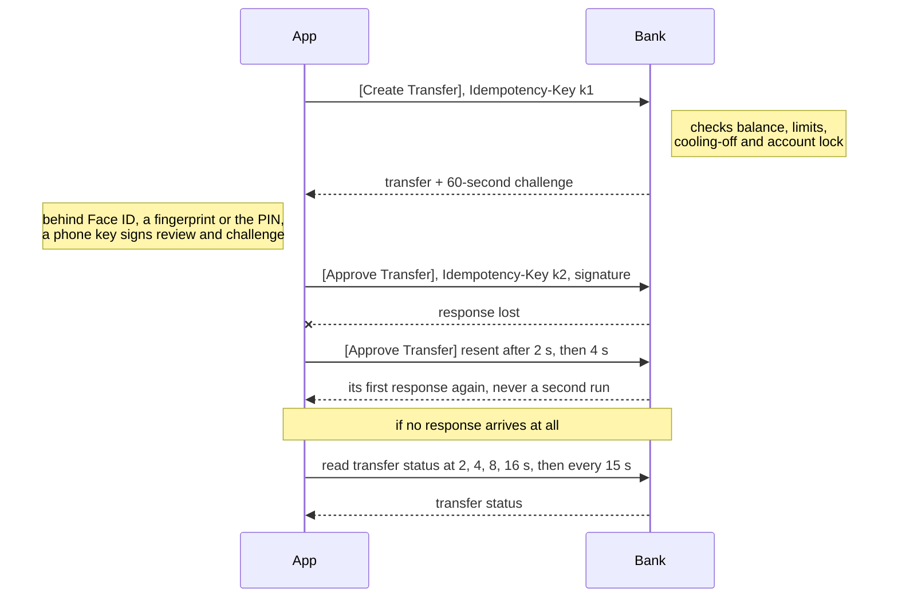
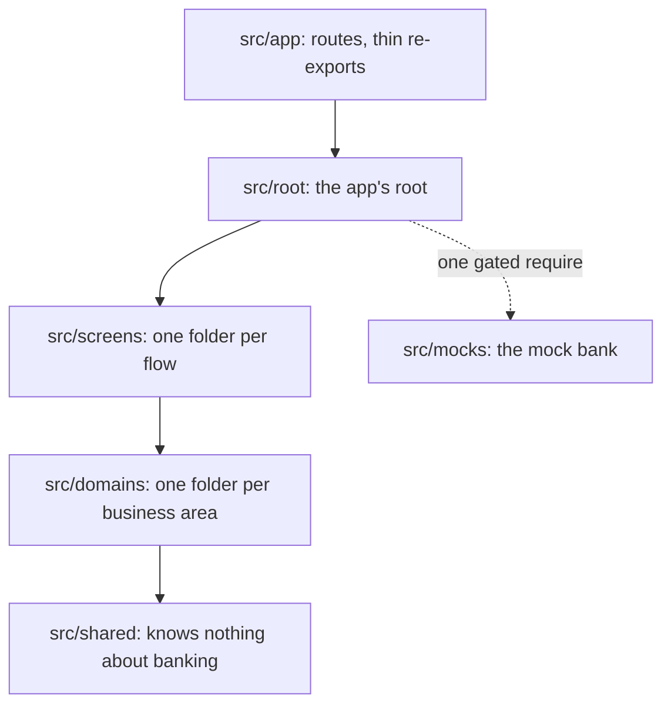

# Write-up

**Transfer flow:**

1. Create Transfer API call
2. Approve Transfer API call

**Notes**

1. Both API calls carry an `Idempotency-Key`:
   1. A transfer is never created or approved twice
   2. With no response (e.g. network loss), FE resends with the same key; BE returns its first response instead of running it again
2. Approve Transfer API call carries a signature ([details](#approval-signs-exactly-what-you-saw)):
   1. BE verifies it covers exactly what review showed (recipient, amount, note, 60-second challenge), so nothing is swapped in between
   2. Signed by a key in the phone's secure hardware, unlocked by Face ID or a fingerprint; without biometrics, a PIN BE checks

## Approval signs exactly what you saw

A pass/fail biometric prompt proves nothing to BE. Here, Face ID or a fingerprint unlocks a private key in the phone's hardware-backed keystore, which signs the review payload: recipient, amount, note and BE's 60-second challenge. BE verifies the signature, so the payload can't be tampered with between UI and server. Without biometrics, a six-digit PIN that BE verifies goes with a second hardware key's signature; the device passcode approves nothing ([003](deep-dives/design-decisions/003-biometric-approval.md)).

**Rejected:** a fallback key unlocked by the device passcode, which family members often know.

**At scale:** BE's signature verification is the trust boundary, so every client follows the same rule.

## A transfer can never be sent twice

BE creates the transfer first; only the separate Approve API call moves money. Every mutation carries an `Idempotency-Key`, re-sent by every retry, and BE replays its first response to a repeated key for 24 hours, so a lost response is retried safely; an error response never is. If FE's retries never receive a response, FE polls the transfer status, even after an app restart, and offers no retry until it has one ([006](deep-dives/design-decisions/006-never-sent-twice.md)).

**Rejected:** a single API call that validates and moves money, whose validation errors would arrive only after approval.

**At scale:** the guarantee is BE's API contract, so a web or lite client gets it by following the contract.

## Every scenario is written down once

Each of the 58 scenarios a transfer can hit is one short section of [the scenario matrix](../src/screens/transfer/scenarios/transfer.md): the money state, the user-facing message and, where it matters, which actions are forbidden. Tests, the mock BE, i18n and the Demo menu share its stable scenario ids. Money is always one of four states; where the user must be told it, every locale carries that state's fixed phrase, and where a retry is forbidden, no pressable element may carry one of nine retry words. [A check](../src/screens/transfer/scenarios/transfer.strings.check.test.ts) fails a scenario's strings that break either rule, and [another](../src/screens/transfer/scenarios/transfer.check.test.ts) fails scenario ids that drift apart ([002](deep-dives/design-decisions/002-scenario-matrix.md)).

**Rejected:** exact copy in the matrix, which would bind every client to one wording.

**At scale:** every client and rewrite implements against the same file, which product owners can edit.

## Fast with a long history

The mock BE seeds 5,000 transfers. Cursor pagination returns pages of 30, and BE returns each day's count and net total, so a day split across pages never under-counts. FlashList recycles rows. Reopened within 30 seconds of its last fetch, History renders from cache without a request; after that, it refetches the first page once, since a user checking before re-sending needs fresh data. Before the latest History changes, I [counted re-renders](deep-dives/history-re-render-counts.md) rather than trust an emulator's frame rate: appending a page or collapsing a day re-renders no visible row, and a status change re-renders one ([009](deep-dives/design-decisions/009-history-at-scale.md)). Server state lives in TanStack Query's cache ([010](deep-dives/design-decisions/010-query-cache-only.md)), flow state in a typed zustand reducer ([005](deep-dives/design-decisions/005-state.md)), and the React Compiler memoizes, with three manual memos where referential stability matters.

**Rejected:** offset pagination, which duplicates a row on the next page when a transfer lands mid-scroll.

**At scale:** cursors and day totals are BE's contract, so every client paginates and totals the same way.

## Every component and hook has one place

The app uses vertical slices: a screens folder per flow, a domain per business area. A component, hook or module is colocated with the one screen using it until a second screen, then a second flow, needs it. A small module with a single importer folds into it, but nothing folds into a component file: a child used by one component is inlined or gets its own folder. Each layer imports only from layers below: the placement check fails a piece placed higher than its consumers need, and the boundary lint fails a sideways or upward import ([001](deep-dives/design-decisions/001-vertical-slices.md), [011](deep-dives/design-decisions/011-low-mental-load.md), [012](deep-dives/design-decisions/012-inline-or-own-folder.md)).

**Rejected:** Feature-Sliced Design, whose six layers split each feature, making "which layer?" a recurring call.

**At scale:** placement follows from the tree, so engineers put the same piece in the same place.

## One mock BE for tests and the demo

Development and demo builds ship a stateful mock BE that updates balances, consumes limits, replays a repeated idempotency key's first response and verifies signatures. One set of MSW handlers serves it in Jest and on device, where the app's transport layer routes each request to MSW. Its state persists across app restarts, and a Demo menu switches it into any scenario BE or the network can produce ([004](deep-dives/design-decisions/004-mock-backend.md)).

**Rejected:** a local mock server: closest to production, but an installed APK has no server to reach.

**At scale:** an API contract change lands once for tests and the demo, and QA can walk any scenario on an installed build.

## The mock BE can't reach production

An unset build variant means production, so a misconfigured build fails closed. Mock code is reachable only through one `require` in the app's root, gated on a literal comparison of `EXPO_PUBLIC_APP_VARIANT`, the one form Metro dead-code-eliminates from a release bundle; lint lets only the root `require` it, and no app code imports it except the root's type-only import of the demo contract, which emits no code. On every push, CI exports each variant and fails a production or unset bundle whose source map lists a mock or MSW file; the demo export must include them ([007](deep-dives/design-decisions/007-production-guard.md)).

**Rejected:** one build with a hidden demo mode: the mock BE would ship one unlock away from a customer.

**At scale:** the check inspects the built artifact, not the intent, so it holds as the team grows.

## Security beyond the fingerprint

In production, screen capture is blocked on every screen except the two receipts, kept as proof of payment, and a new screen is blocked by default unless marked a receipt. Each approval is refused on a device that clearly reports root, a jailbreak or runtime hooking; an inconclusive check, or none within 5 seconds, lets it through and is logged. iOS blurs the app in the app switcher, and on Android the PIN pad drops touches passed through another app's overlay (tapjacking) ([008](deep-dives/design-decisions/008-hardening.md)).

**Rejected:** blocking capture only on the transfer steps, leaving History's names and amounts capturable.

**At scale:** on-device checks are a second layer a rooted device can bypass; the real control is BE attesting the device.

## Challenges

**Back during the integrity check didn't cancel the transfer.** In production, every approval awaits a fresh root/jailbreak check. An audit found that pressing Transfer, then Back during that await, still created the transfer and showed the biometric prompt over the previous screen. The press handler now re-checks that review is still the focused screen after every await.

**A bottom-sheet library, reverted on evidence.** I first picked the popular library. Its issue tracker had open reports, on this exact React Native and Reanimated stack, of sheets that render invisible or never reopen. The app now ships its own sheet, about 250 lines.

**A production bundle could include the mock BE.** Metro's cache key omitted the build variant, so a production build right after a demo build reused the demo's transformed files. The variant is now part of the cache key, and CI fails any exported production bundle containing mock code.

## Limits, and what I'd do next

- Only screen layouts were verified on a physical device, which also recorded the demo video. Next: verify the hardware keys, the Secure Enclave and screenshot blocking on real devices.
- Device integrity is checked client-side. Next: BE verifies it server-side, with Play Integrity and App Attest.
- Malay and Chinese are unreviewed machine translations. Next: a native speaker's review.
- The API is a proposed contract. Next: agree it with the bank's BE team.

Full list: [limitations.md](deep-dives/limitations.md)
