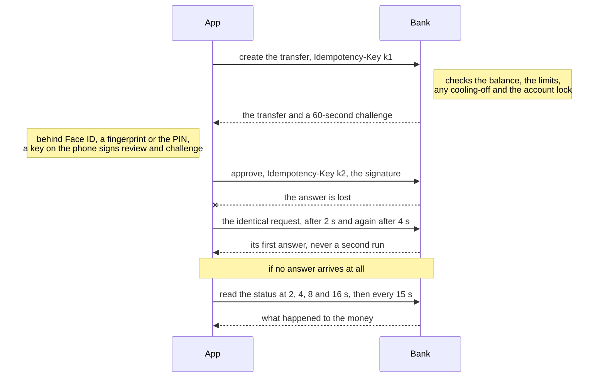
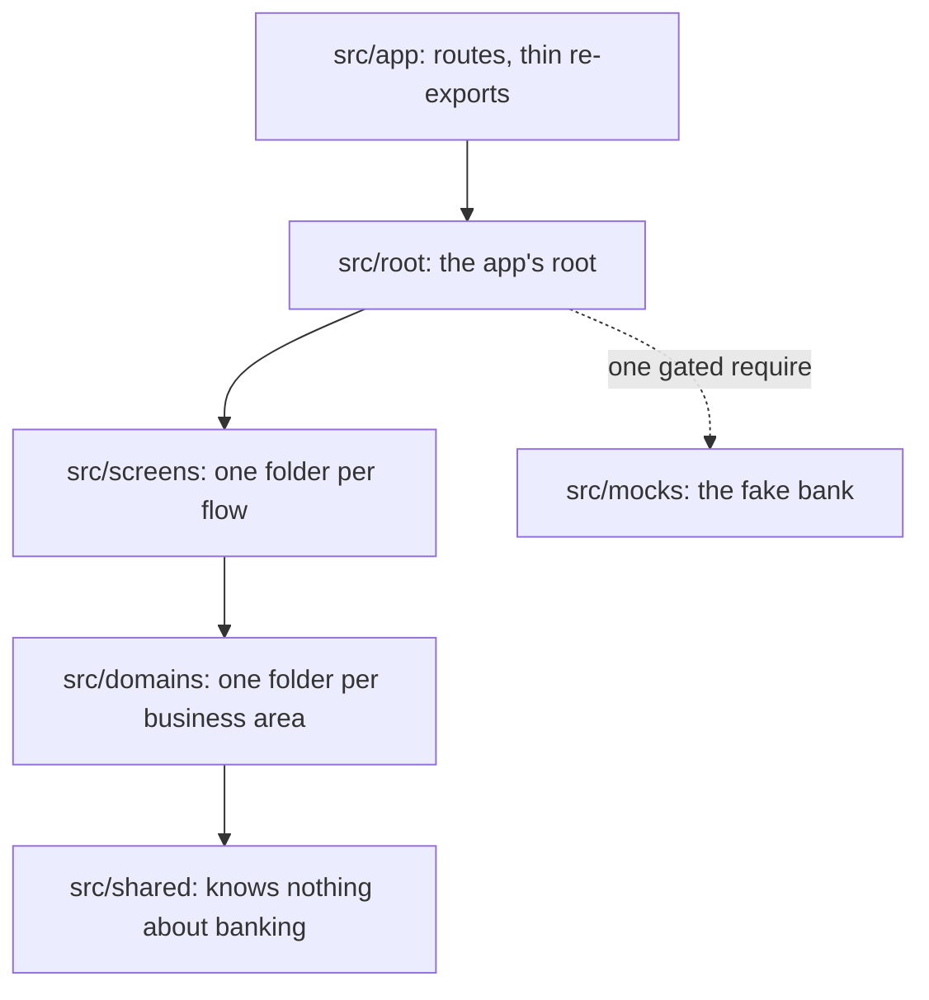

# Write-up

In short: a transfer is created, then approved; only the signed approval moves money. Every write carries an `Idempotency-Key`, so a lost answer is resent safely, since the bank returns its first answer, and then checked, never guessed. The signature, made on the phone behind Face ID, a fingerprint or a PIN the bank checks, proves to the bank who approved exactly what. Every scenario lives in one file that the tests, the mock bank and the app's words all follow.

## Approval signs exactly what you saw

A yes-or-no biometric prompt proves nothing to the bank. Here, Face ID or a fingerprint unlocks a key in the phone's secure hardware that signs what review showed: recipient, amount, note and the bank's 60-second challenge. The bank checks the signature, so nothing can be swapped between screen and server. Without biometrics, a six-digit PIN the bank checks goes with a second hardware key's signature; the phone's passcode approves nothing ([003](decisions/003-biometric-approval.md)).

**Rejected:** a fallback key the phone's passcode unlocks, since family often knows it.

**At scale:** the bank's signature check is the trust boundary, so every client is held to the same rule.

## A transfer can never be sent twice

The bank creates a transfer first; only a separate approval moves money. Every write carries an idempotency key, reused by every repeat of the same act, and the bank returns its first answer to a repeated key for 24 hours, so a lost answer is resent safely; a refusal never is. If the approval's answer stays lost, the app asks the bank for its status, even after a restart, offering no resend until it knows ([006](decisions/006-never-sent-twice.md)).

**Rejected:** one call that checks and moves money, whose refusals would arrive only after approving.

**At scale:** the guarantee is the bank's API contract, which a website or a lite app gets by following it.

## Every scenario is written down once

Each of the 58 situations a transfer can meet is one short section of [the scenario matrix](../src/screens/transfer/scenarios/transfer.md): what happened to the money, what to tell the person and, where it matters, what never to offer them. Tests, the mock bank, translations and the Demo menu share its permanent ids. The money is always one of four states; where the person must be told it, every language carries that state's fixed phrase, and where a resend is forbidden, nothing pressable may carry one of nine retry words. [A check](../src/screens/transfer/scenarios/transfer.strings.check.test.ts) fails a scenario's words that break either rule, and [another](../src/screens/transfer/scenarios/transfer.check.test.ts) ids that drift apart ([002](decisions/002-scenario-matrix.md)).

**Rejected:** the exact sentences in the matrix, which would bind every client to one wording.

**At scale:** every client and rebuild implements from the same file, which product owners can edit.

## Fast with a long history

The demo bank seeds 5,000 transfers. Pages of 30 come by cursor, and each day's count and net come from the bank, so a split day never reads short. FlashList recycles the rows. Reopened within 30 seconds of its last read, History draws what it holds and asks nothing; later, it asks once for the newest page, since someone checking before sending again needs it current. Before the latest history changes, I [counted re-renders](history-re-render-counts.md) rather than trust an emulator's frame rate: a new page or a folded day redraws no row already on screen, a status change redraws one ([009](decisions/009-history-at-scale.md)). Bank data lives in TanStack Query's cache ([010](decisions/010-query-cache-only.md)), the flow in a typed zustand reducer ([005](decisions/005-state.md)), and the React Compiler memoizes, with three hand-written memos where a reference must stay stable.

**Rejected:** offset paging, where a transfer made mid-scroll repeats a row on the next page.

**At scale:** the cursor and day totals are the bank's contract, so every client pages and totals alike.

## Every component and hook has one place

The app is cut into vertical slices: a screens folder per flow, a domain per business area. A component, hook or module stays in the one screen using it until a second screen, then a second flow, needs it, and a small one with a single user folds into that user's file. Each layer imports only those below it: the placement check fails a piece placed higher than its users need, and the boundary lint an import running sideways or up ([001](decisions/001-vertical-slices.md), [011](decisions/011-low-mental-load.md)).

**Rejected:** Feature-Sliced Design, whose six layers split each feature, so "which layer?" becomes a recurring call.

**At scale:** where new code goes reads off the tree, so engineers file the same piece in the same place.

## One fake bank for tests and the demo

Development and demo builds carry a stateful mock bank that moves balances, uses up limits, replays a repeated key's first answer and verifies signatures. One set of msw handlers answers for it in Jest and on a phone, where the app's own transport hands each request to msw. They keep it across restarts, and a Demo menu switches it into any scenario the bank or the connection can cause ([004](decisions/004-mock-backend.md)).

**Rejected:** a local mock server: the most production-like, but an installed APK has no server to reach.

**At scale:** a contract changes once for tests and demo, and QA can walk any scenario on an installed build.

## The fake bank can't reach production

An unset variant means production, so an unconfigured build fails closed. Mock code is reached only by one `require` in the app's root, gated on a literal comparison of `EXPO_PUBLIC_APP_VARIANT`, the one form the bundler strips from a release build; lint lets only the root `require` it, and no app code import it but the root's type-only import of the demo contract, which carries no code. On every push, CI exports each variant and fails a production or unset bundle whose source map lists a mock or msw file; the demo export must carry them ([007](decisions/007-production-guard.md)).

**Rejected:** one build with a demo mode to unlock: the fake bank would ship one unlock away from a customer.

**At scale:** the check reads what was built, not what was meant, so it holds as the team grows.

## Security beyond the fingerprint

In production, capture is blocked on every screen but the two receipts, kept as proof of payment, and a new screen is blocked unless named a receipt. There, each approval refuses on a phone that clearly reports root, a jailbreak or runtime hooks, while an unclear check, or none within 5 seconds, lets it through, logged. iOS blurs the app in the switcher, and on Android the PIN pad ignores touches through another app's overlay ([008](decisions/008-hardening.md)).

**Rejected:** blocking capture on the transfer steps only, leaving History's names and amounts capturable.

**At scale:** on-phone checks are a second layer a rooted phone can fool; the real control is the bank verifying the phone.

## Challenges

**Back during the phone check didn't stop the transfer.** In production, every approval waits for a fresh rooted-phone check. An audit found that pressing Transfer, then Back during that wait, still created the transfer and raised the prompt over the screen they'd gone back to. The press now re-checks that review is still open after every wait.

**A bottom-sheet library, reversed on evidence.** I first picked the common library. Its issue tracker held unfixed reports, on this exact React Native and Reanimated stack, of sheets that go invisible or never reopen. The app now draws its own sheet, about 250 lines.

**A production bundle could carry the fake bank.** The bundler's cache key left out the build variant, so a production build made right after a demo one reused the demo's files. The variant is now in the key, and CI fails any production bundle it exports that carries mock code.

## Limits, and what I'd do next

- Nothing ran on a physical phone. Next: prove the hardware keys, the Secure Enclave and the screenshot block on real devices.
- The phone's integrity is checked on the phone. Next: the bank verifies it server-side, with Play Integrity and App Attest.
- Malay and Chinese are machine translations no one reviewed. Next: a native speaker's review.
- The API is a proposed contract. Next: agree it with the bank's backend.

Full list: [limitations.md](limitations.md)
